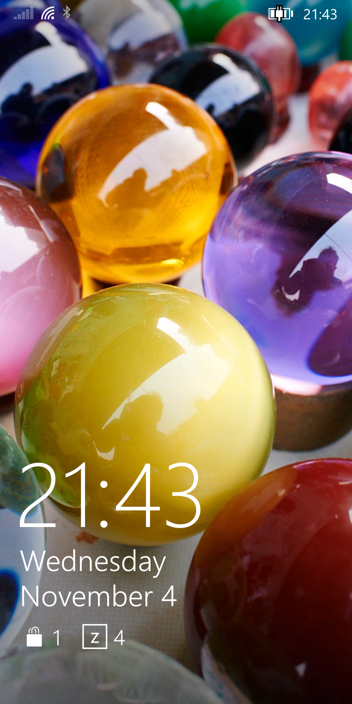

# ztOS on the Google Pixel 3a XL (bonito)

[ztOS](https://ztos.online/) is a phone OS with a Windows Phone 8.1–style shell (ztMETRO) on
Arch Linux ARM. This folder shows how to build it for the **Pixel 3a XL** (Snapdragon 670) with
[ztConflo](https://github.com/Zerone-Laboratories/ztconflo), and records **everything that had to
be fixed** to get a working phone. ztConflo's output does not boot to a usable system on its own yet.

**Status:** experimental cross port, tested on one Pixel 3a XL (Samsung panel) on 2026-11-04.
ztOS GSI 0.2.1, kernel `linux-postmarketos-qcom-sdm670` 7.2.3 (mainline).

| Works | Partly | Doesn't work in ztOS yet | Not tried |
|---|---|---|---|
| Boot from internal storage, panel, GPU (Adreno 615, GLES 3.2), touch, ztMETRO, Wi-Fi (2.4 and 5 GHz), Bluetooth (scan), USB networking, speaker (with boost), microphone, vibration, brightness control and auto brightness, light, accelerometer and proximity sensors, battery and charging readout, CPU frequency scaling, A/B slot marking, software updates, Waydroid (starts at login, freezes when idle), flashlight tile, Devices and Services and Settings describing this phone | Cameras, back and front (1280×960, autofocus, digital zoom; uncalibrated colour, noisy in dim light); calls, SMS and mobile data: ModemManager bridged to ztMETRO, Phone and Messages, untested without a SIM, no call audio | GPS; screen rotation (ztMETRO has none) | Headphones, headset mic, suspend |

## Install

**→ [INSTALL.md](INSTALL.md)**: the full step-by-step guide. It erases the phone.

## What was fixed

**→ [FIXES.md](FIXES.md)**: 35 problems, each with its symptom, cause and fix. In short:

- **ztConflo:**
  - doesn't pick a kernel variant or device tree for this two-panel phone;
  - leaves out the Qualcomm firmware and UCM;
  - enables `rmtfs`/`tqftpserv` without shipping them;
  - never adds `alarm` to `video`/`input`/`audio`, so there's no vibration;
  - writes `"auto"` into the ztOSIAL manifest, which the GSI reads literally.
- **ztOS:**
  - the GSI's `/etc/fstab` makes the postmarketOS initramfs halt;
  - ships the Galaxy S9's component list, torch name and modem daemons;
  - its Devices and Services and Settings apps describe the S9, whatever phone they run on.
- **Kernel:** no Landlock, so pacman 7 can't download updates.
- **Sensors, speaker, Android:** the sensor DSP needed its file root, iio-sensor-proxy tags and an auto-brightness stand-in for the S9 daemon; the speaker amps' boost was off; ztOS's Waydroid helpers were never installed.
- **Phone:**
  - an old GPT on `userdata` overwrote the new root filesystem;
  - nothing marked the A/B boot slot successful.

## Files in this folder

| Path (in this folder) | What it is |
|---|---|
| `INSTALL.md` | The installation guide |
| `FIXES.md` | Symptom, cause and fix for every problem |
| `files/` | Files installed on the phone, laid out from `/`: systemd units, the Bluetooth address helper, udev rules, NetworkManager and ld.so config, the ztoscsf component list, the auto-brightness daemon, and the ModemManager bridge `ztos-mm-modemd` |
| `patches/ztconflo-kernel-variant.diff` | Lets ztConflo take the kernel variant from `$ZT_KERNEL` |
| `patches/ztcamera-libcamera.diff` | Gives ztCamera both cameras through libcamera, with autofocus and 1×/2×/4× zoom (INSTALL.md step 14) |
| `patches/ztdevices-any-phone.diff` | Lets Devices and Services find any phone's hardware, not only the S9's (INSTALL.md step 15) |
| `patches/ztsettings-device-info.diff` | Shows this phone's model, SoC, CPU clusters, GPU, panel, battery and storage in Settings (step 15) |
| `patches/ztmetro-torch-led.diff` | Lets the flashlight tile use a mainline `*:torch` or `*:flash` LED (step 15) |
| `patches/ztos-waydroid-boot.diff`, `patches/ztos-waydroid-recover.diff` | Keeps Android from being frozen while it boots; `ztos-waydroid-recover ready` sets the boot's ready mark (applied in INSTALL.md step 13) |

## Upstream reports

Reported to the ztOS developers:

- [Multi-kernel devices get an empty `kernel =`](https://github.com/Zerone-Laboratories/ztconflo/issues/1)
- [`dtb_<variant>` ignored, so boot.img has no DTB](https://github.com/Zerone-Laboratories/ztconflo/issues/2)
- [Firmware dependencies and UCM not installed](https://github.com/Zerone-Laboratories/ztconflo/issues/3)
- [Daemons enabled but not shipped; `/vendor/ztos/udev` never read](https://github.com/Zerone-Laboratories/ztconflo/issues/4)
- [Comment-only fstab halts the pmOS initramfs](https://github.com/Zerone-Laboratories/ztconflo/issues/5)
- [Stale backup GPT on userdata restored over the root](https://github.com/Zerone-Laboratories/ztconflo/issues/6)
- [No qbootctl, so the A/B slot falls back](https://github.com/Zerone-Laboratories/ztconflo/issues/7)
- [GSI 0.2.1 release has no files (404)](https://github.com/Zerone-Laboratories/ztos-build/issues/1)

## References

- ztOS: [ztos.online](https://ztos.online/) · [Supported devices](https://devices.ztos.online/) ·
  [ztOS](https://github.com/Zerone-Laboratories/ztOS) · [ztConflo](https://github.com/Zerone-Laboratories/ztconflo) ·
  [ztos-build](https://github.com/Zerone-Laboratories/ztos-build)
- postmarketOS: [Pixel 3a XL wiki](https://wiki.postmarketos.org/wiki/Google_Pixel_3a_XL_(google-bonito)) ·
  [Pixel 3a wiki](https://wiki.postmarketos.org/wiki/Google_Pixel_3a_(google-sargo)) ·
  [Snapdragon 670](https://wiki.postmarketos.org/wiki/Qualcomm_Snapdragon_670_(SDM670)) ·
  [device-google-bonito](https://gitlab.postmarketos.org/postmarketOS/pmaports/-/tree/master/device/community/device-google-bonito) ·
  [pmbootstrap](https://gitlab.postmarketos.org/postmarketOS/pmbootstrap) ·
  [debug shell](https://wiki.postmarketos.org/wiki/Debug_shell)
- Qualcomm userspace (linux-msm): [rmtfs](https://github.com/linux-msm/rmtfs) · [tqftpserv](https://github.com/linux-msm/tqftpserv) ·
  [qrtr](https://github.com/linux-msm/qrtr) · [qbootctl](https://github.com/linux-msm/qbootctl) · [hexagonrpc](https://github.com/linux-msm/hexagonrpc)
- [Arch Linux ARM](https://archlinuxarm.org/)
- Google: [factory images](https://developers.google.com/android/images) · [flash.android.com](https://flash.android.com/) ·
  [bootloader unlocking](https://source.android.com/docs/core/architecture/bootloader/locking_unlocking)

## Credits

ztOS and ztConflo by [Zerone Laboratories](https://github.com/Zerone-Laboratories). The kernel, the initramfs, the firmware
packaging and the UCM come from [postmarketOS](https://postmarketos.org/). The Qualcomm daemons come from [linux-msm](https://github.com/linux-msm).
Port and write-up by Vachagan Grigoryan.

## License

MIT for the scripts, units and docs here (see [LICENSE](../../LICENSE)). The upstream projects keep their own licenses.
